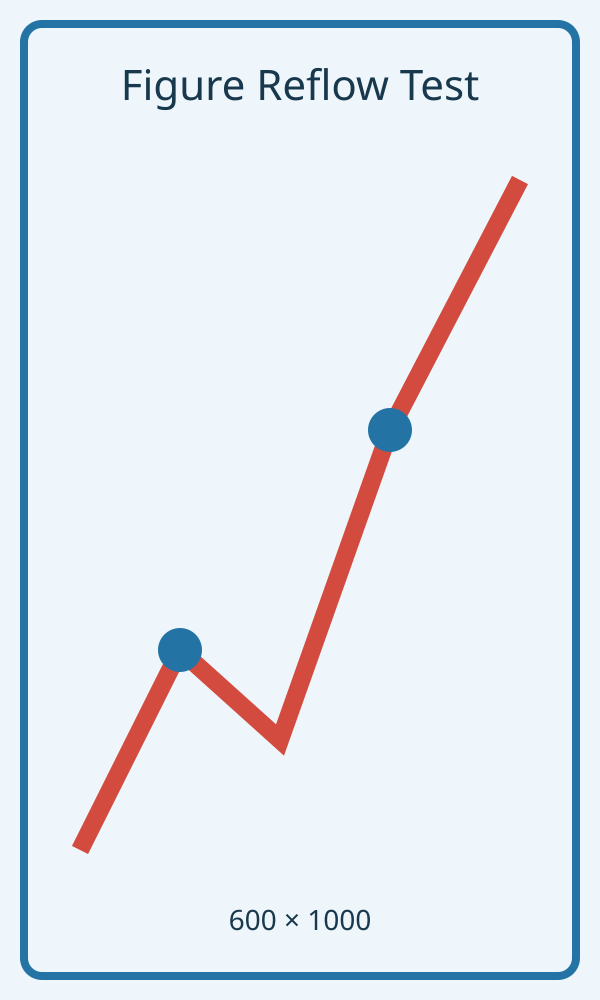

# 图片分页回填测试

## 1 当前小节

前置段落一用于建立图片之前的页面占用。该段连续说明研究背景、资料基础、分析范围与主要认识，使大图到达当前页面中后部。

前置段落二继续补充构造格架、断裂活动和岩浆响应等信息。这里的文字只用于跨平台运行时测试，不包含外部文献引用。

前置段落三用于模拟论文正文的正常长度。导出器应保持这些段落的原始先后顺序，不应为了图片分页而移动图片之前的文字。

前置段落四继续占用当前页面。图片与图题仍需作为一个完整图块处理，不能将图题单独遗留在上一页或下一页。

前置段落五用于触发较大的剩余空白。若图块无法放入当前页，后续同一小节的正文可以提前显示，以回填原本的空白区域。

前置段落六结束图片之前的正文。随后是一张纵向大图，其显示高度会受到版心建议高度限制，并保持原始宽高比。

{#fig:page-fill width=100%}

回填段落一应在导出的 Word 中移动到大图之前，但在源 Markdown 中仍位于大图之后。段落内部文字、公式和引用结构不得改变。

回填段落二继续填充大图换页前的剩余区域。自动回填只能移动完整正文段落，不能拆散图题、图注或表格内容。

回填段落三用于覆盖剩余高度估算的边界情况。算法允许正文自然跨页，但不允许改变正文段落彼此之间的先后顺序。

回填段落四继续提供可移动正文。若前面的段落已经消除大段空白，算法应停止移动，避免把图片无意义地推到小节末尾。

回填段落五用于较大图片场景。无论移动多少段，图像仍保持嵌入型，图题保持居中，并与图片连续排列。

回填段落六用于验证多段移动。导出完成后，自检报告应给出回填图片数量、提前正文段数和纵向缩放图片数量。

回填段落七是当前小节内最后一个可移动段落。算法遇到下一个标题时必须停止，不能把下一小节的正文提前。

## 2 下一小节

边界段落不得移动到上一张图片之前。

## 参考文献
